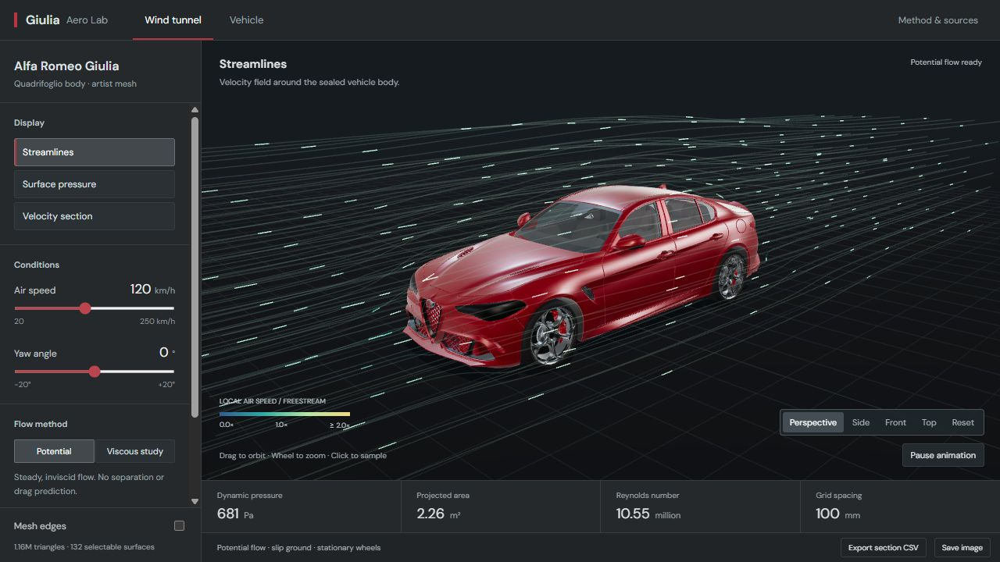

# Giulia Aero Lab

A local 3D aerodynamic exploration app built around a detailed **Alfa Romeo Giulia** mesh. It combines an interactive Three.js scene, a numerical potential-flow field, and a Windows desktop shell.

A compact desktop workspace for airflow studies and vehicle inspection. All required rendering assets are bundled locally. The numerical methods are exploratory, not validated automotive CFD.



## Features

- Approximately **1.16 million triangles**, organized into **132 selectable surfaces**.
- Orbit, zoom, camera presets, studio lighting, and revised paint/glass/trim materials.
- Adjustable air speed and wind angle.
- Streamlines, surface-pressure coloring, velocity slices, and near-surface probes.
- Vehicle-only workspace with no airflow overlays.
- Searchable exterior/cabin catalogue, click selection, highlighting, focus and isolation.
- Cabin cutaway using actual seats, headrests, steering-wheel rim and trim geometry.
- Reduced-Re viscous experiment with progress, pause/resume, restart and a bounded run.
- CSV section export and PNG scene capture.
- Electron desktop window with tray controls, offline assets and fonts, and saved wind settings.
- Nine automated checks, plus a full 2,000-step numerical solver check.

## Run locally

Use **Node.js 22.12 or newer**.

### Local preview — no dependency installation required

```sh
git clone https://github.com/4onv/giulia-aero-lab.git
cd giulia-aero-lab
node tools/serve.mjs
```

Open **http://127.0.0.1:8766**. This serves the bundled app only on your computer.

### Desktop app

```sh
npx pnpm@11.25.0 install --frozen-lockfile
node node_modules/electron/install.js
npm run desktop
```

The explicit Electron installation step also works when package-manager lifecycle scripts are disabled. The close button hides the app to the tray; use the tray menu to reopen, keep it on top, or quit.

To build the Windows portable folder:

```powershell
powershell -File tools/package-desktop.ps1
```

Run `desktop-app/Giulia Aero Lab.exe` and keep its surrounding files together. Generated executables and dependencies are intentionally excluded from this source repository.

## How the airflow works

The visible car mesh is converted into a sealed outer envelope on a **136 × 48 × 72** grid at **100 mm** spacing. Two finite-volume Laplace solutions form the longitudinal and lateral velocity bases. Their linear combination represents the selected wind angle, and streamlines are integrated through the resulting 3D field.

The ideal-flow pressure coefficient is calculated as `Cp = 1 − (local speed / freestream speed)²`. Solid cells are excluded from fluid interpolation. Rendering detail is substantially finer than the computational grid.

### Experimental viscous solver

`solver/lbm.c` implements a D3Q19 lattice Boltzmann solver compiled to WebAssembly, with BGK collision, a static Smagorinsky closure, no-slip vehicle boundaries, slip ground, and a startup ramp. It runs in a worker and uses density-derived pressure.

The enabled experiment uses **Re 500 at zero yaw**, ramps up over 400 steps, and stops at **2,000 steps**. Speed and yaw controls are locked during the run. Calculation runs in a worker and pauses when the window is hidden or Vehicle mode is active. It can take several minutes, depending on hardware.

The complete run passed a numerical stability check on 1 November 2026: density stayed between 0.99744 and 1.00893, and the downstream probe showed a velocity deficit. See [the recorded numerical check](docs/solver-check.json). This does not establish agreement with a real wind tunnel or convergence to steady flow.

## Accuracy and limitations

This is an exploratory project, **not validated automotive CFD**. The default inviscid method cannot predict viscous drag, boundary layers, separation, or a turbulent wake. Neither mode provides a validated drag/lift coefficient. The car is an existing artist asset, not manufacturer-certified CAD.

The catalogue identifies visible surfaces and some combined assemblies, not every mechanical component. Unmapped meshes are labelled as such. The existing asset has **no complete engine assembly** and no source textures. It cannot provide factory-accurate inspection under the bonnet. See [asset research and model scope](docs/model-scope.md).

## Tests and solver builds

```sh
npm test
npm run solve
```

The standard tests cover field integrity/convergence, fluid interpolation, yaw blending, streamline integrity, physical scale, viscous pressure sampling, geometry preservation, and worker pause/completion behavior. They are numerical checks, not wind-tunnel validation.

To rebuild the experimental solver, install **Zig 0.15.2**, then run:

```powershell
powershell -File tools/build-solver.ps1 -Zig "C:\path\to\zig.exe"
npm run test:viscous
```

The long viscous test is intentionally separate from the quick test suite. It writes a validation report only after successful completion.

## Project structure

| Path | Purpose |
| --- | --- |
| `dist/` | App source, local rendering libraries, and required assets |
| `desktop/` | Electron window, tray, protocol and preload code |
| `solver/` | Experimental C solver and method notes |
| `tools/` | Local server, potential-flow solver and build/package scripts |
| `tests/` | Numerical and data-integrity checks |

## Controls

- **Wind tunnel:** choose streamlines, pressure or a velocity section; click the car for a near-surface sample.
- **Vehicle:** search or click a surface; use Focus, Isolate or Show all. Cabin hides the exterior shell.
- Drag to orbit, wheel to zoom, right-drag to pan. Camera presets restore an overall view.
- Space pauses the flow; F focuses a selected component; Escape clears selection.
- Closing the native window hides it to the tray. The tray menu offers Open, Keep on top and Quit.

## Credits and asset terms

See [THIRD_PARTY_NOTICES.md](THIRD_PARTY_NOTICES.md) and [MODEL-LICENSE.txt](MODEL-LICENSE.txt). The vehicle is included only as part of this non-commercial application; do not redistribute it as a standalone asset. Third-party assets and libraries retain their own terms. No blanket open-source licence is granted for the complete repository.

This project is not affiliated with or endorsed by Alfa Romeo.
